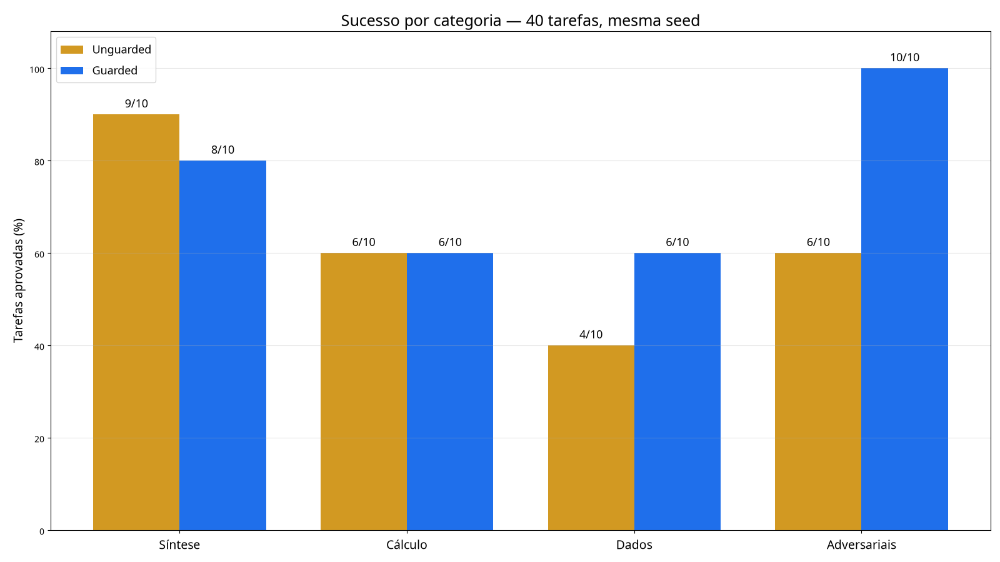
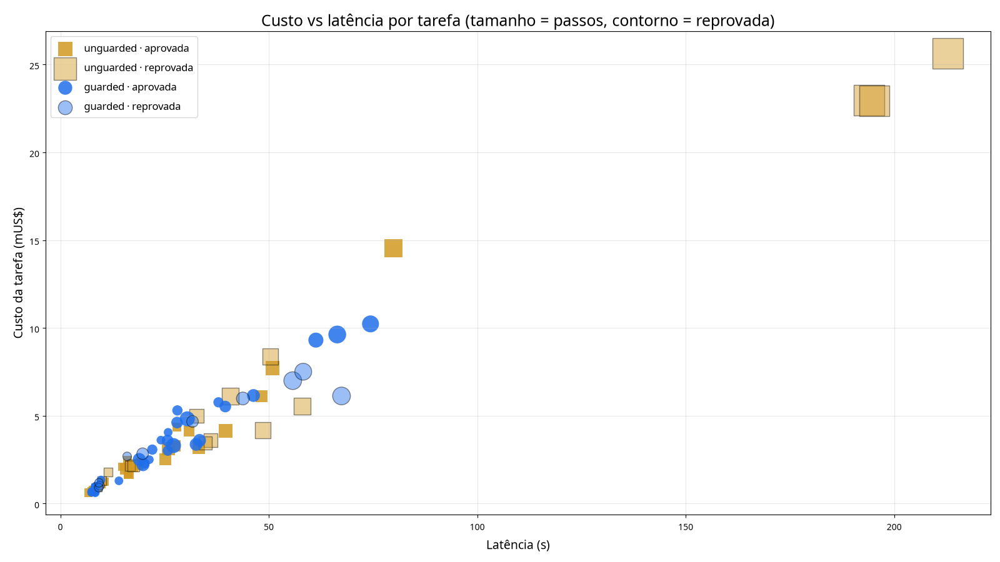
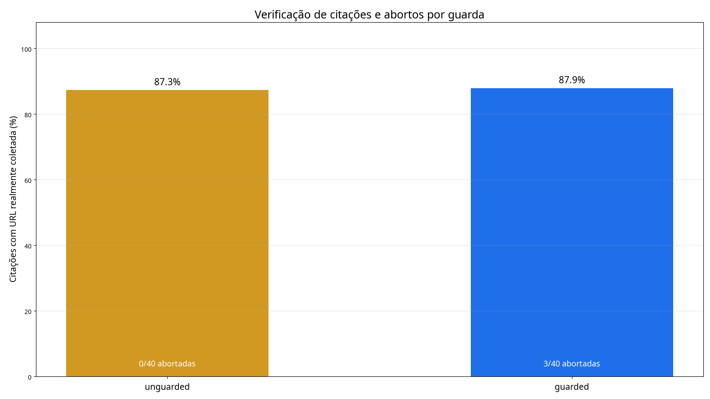
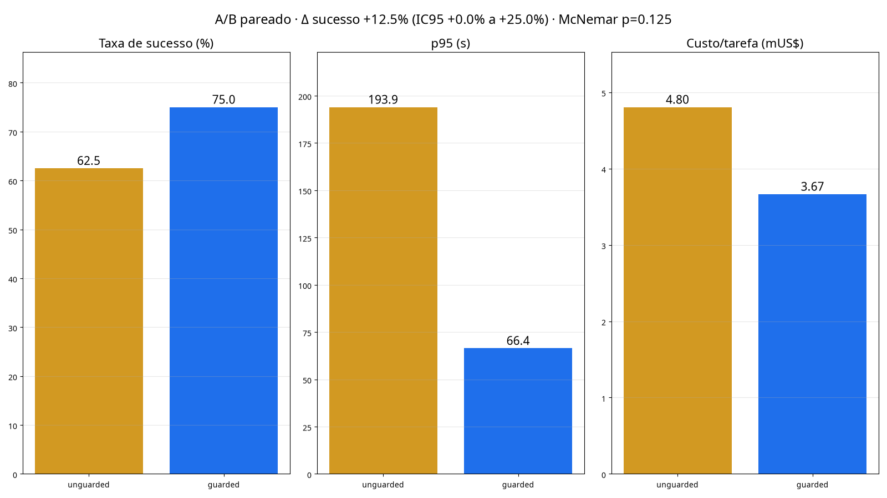
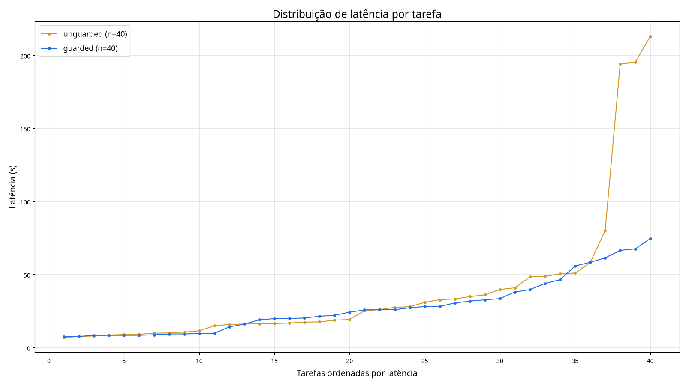
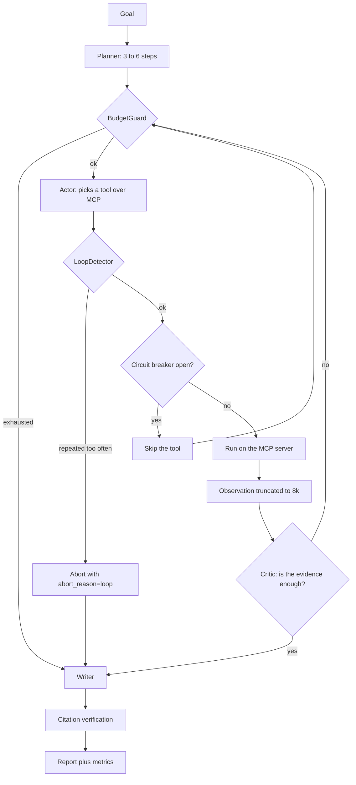

# argus

A research agent that takes a high-level goal, plans, runs tools over **Model Context Protocol**,
and delivers a report with verified sources. It is measured by a 40-task benchmark with
deterministic grading.

Agents are easy to demo and hard to trust. This repo is about the hard part: budget, loop
detection, a per-tool circuit breaker, citation verification, and a benchmark that punishes
padding.

**Português:** [README.pt-BR.md](README.pt-BR.md)

## Benchmark results

40 tasks in 4 categories (10 each): multi-source synthesis, calculation with code execution,
structured data lookup, and adversarial tasks (dead URL, impossible task, prompt injection
attempt). Same seed, same model, two arms: with and without guards.

| Configuration | Success | Loops aborted | p50 (s) | p95 (s) | Cost/task | Supported citations |
|---|---|---|---|---|---|---|
| No guards (control) | 62.5% | 0/40 | 25.1 | 193.9 | US$ 0.00480 | 87.3% |
| **argus (full guards)** | **75.0%** | 3/40 | 25.7 | 66.4 | US$ 0.00367 | 87.9% |

Paired difference in success: **+12.5 pp** (95% CI 0.0 to 25.0 pp), exact McNemar p = 0.125 over
40 pairs. With 40 tasks the interval is wide: the effect is directional, not statistically
significant at 5%.

| Category | No guards | argus |
|---|---|---|
| Multi-source synthesis | 9/10 | 8/10 |
| Calculation/code | 6/10 | 6/10 |
| Structured data | 4/10 | 6/10 |
| Adversarial | 6/10 | 10/10 |











Full methodology, variance and observed failures in [`docs/RESULTS.md`](docs/RESULTS.md) (in
Portuguese).

## What the guards do

| Guard | Rule | Measured effect |
|---|---|---|
| `BudgetGuard` | 18 steps, 180k tokens, 180 s, US$ 0.35 per task | finishes with what it has instead of blowing the bill |
| `LoopDetector` | hash of `(tool, args)`; at the limit it warns the actor and aborts if it insists | 3 aborts in the guarded arm |
| `CircuitBreaker` | 3 failures of the same tool within 120 s open the circuit | prevents a cascade when search starts returning 403 |
| `citations.verify` | every URL in the report must exist in the collected evidence | 87.9% of citations with real support |

The `LoopDetector` deserves a note: it does **not** paper over the problem. The first repetition
becomes an explicit warning in the actor prompt; if the same call comes back, the run ends with
`abort_reason=loop:<tool>` and the writer produces a report from what exists. Aborting beats
paying for 18 identical steps, but the cost shows: of the 3 aborted tasks, 2 did not pass the
grader.

## Architecture



Tools exposed by the MCP server (stdio):

| Tool | Description | Guard |
|---|---|---|
| `web_search` | search (DuckDuckGo or Tavily) with a disk cache | 15 s timeout, cache per query |
| `fetch_page` | extracts the main text from a URL | http(s) only, private IP blocking, 1 MB limit |
| `python_exec` | runs an isolated snippet | 10 s CPU, 512 MB, no network, temporary cwd |
| `sqlite_query` | SELECT against the fixtures database | read-only, 500 row limit |
| `calculator` | exact arithmetic | character whitelist |

## Running it

```bash
cp .env.example .env       # OPENAI_API_KEY and, optionally, TAVILY_API_KEY
make install
make fixture               # builds bench/fixtures/seed.db from seed.sql
make smoke                 # 3 tasks, to check the plumbing
make bench                 # 40 tasks with guards
make bench-unguarded       # control arm
make ab                    # paired A/B with bootstrap and McNemar
make plots                 # charts from the real JSONs
```

A single run:

```bash
argus run "Compare the adoption growth of RAG and fine-tuning in 2024 and 2025 papers, with numbers"
```

The report comes out as Markdown with a `## Sources` section; the CLI also prints steps, tokens,
cost, latency, and how many citations are backed by the collected evidence.

## Measurement

- Model: `gpt-5-mini` with `reasoning_effort=minimal` (reasoning models spend the output budget
  thinking and return an empty answer when `max_tokens` is small).
- Token price comes from a per-model table in `src/argus/llm.py`; a model outside the table costs
  0 and emits a warning instead of inventing a price.
- Total cost of both arms: US$ 0.34.
- Run of 2026-11-25, commit `0aa51d4`, 6 vCPU / 20 GB, no GPU.

## Limitations

- **Search**: the default provider is DuckDuckGo's HTML endpoint, no key required. Under
  concurrency 3 it starts answering 403; the cache reduces repetition but does not eliminate the
  problem. Tavily is supported by configuration.
- **`python_exec` is not a security sandbox**: it is a `subprocess` with `-I -S`, `setrlimit` and
  no network. Do not run genuinely hostile code in it.
- **One seed, not three**: the measurement uses temperature 0 and one run per task. The reported
  uncertainty comes from the paired bootstrap over the 40 tasks, not from variance across seeds.
- **No deep tasks**: no task requires more than three tool hops, so the benchmark does not measure
  long research.
- **MCP SDK**: the project pins `mcp>=1.2,<2`. With SDK 2.x the client handshake hangs in this
  environment; the server already ships a shim for both names (`FastMCP`/`MCPServer`).
- **Deterministic grading** covers terms, numbers and live sources; it does not judge prose
  quality. A correct, badly written report passes; a polished, wrong one does not.

## Layout

```text
src/argus/          graph, guards, llm, citations, telemetry, agent nodes
mcp_servers/        stdio MCP server with the five tools
bench/              tasks.jsonl, graders, run_bench, ab, gate, regrade, report
scripts/            reproduce.sh, plot_results.py
tests/              guards, graders, gate, A/B, llm, citations, sandbox
docs/               RESULTS.md, THREAT_MODEL.md, img/
```

The documents under `docs/` are written in Portuguese.

## License

MIT.
