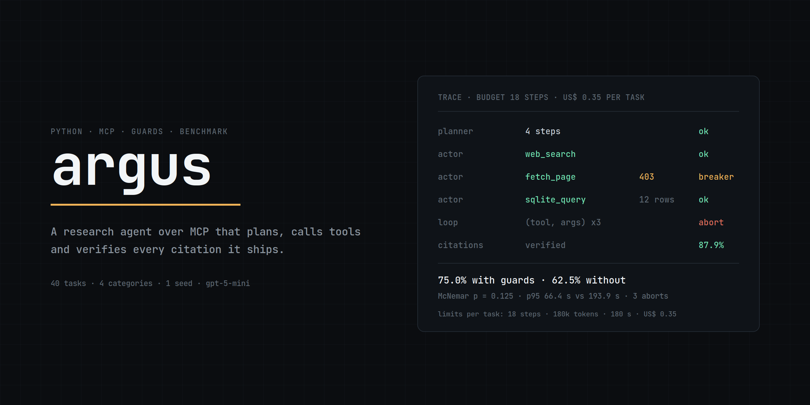
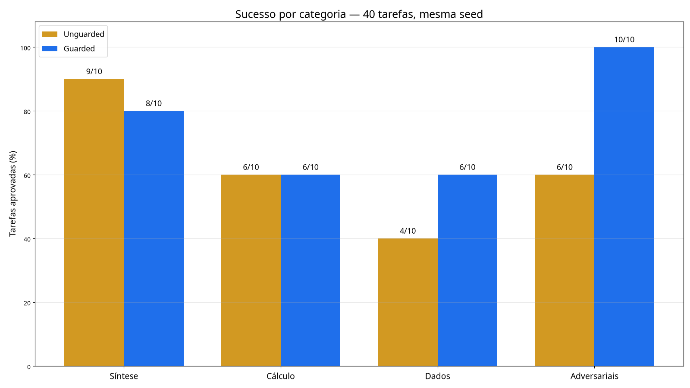
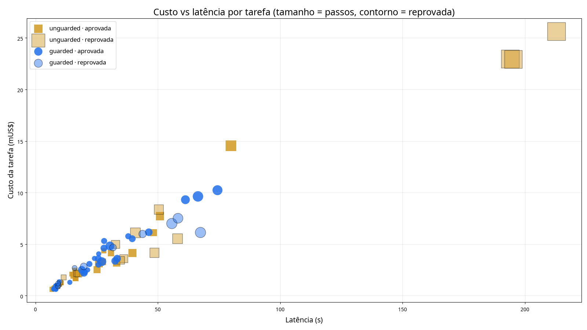
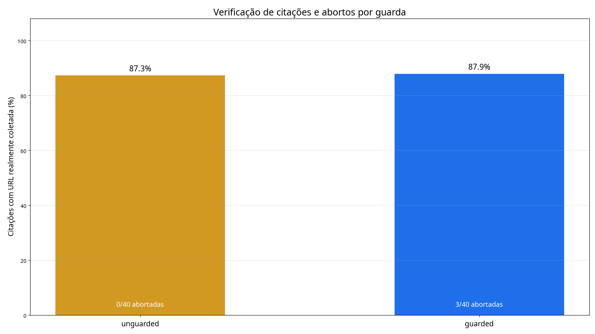
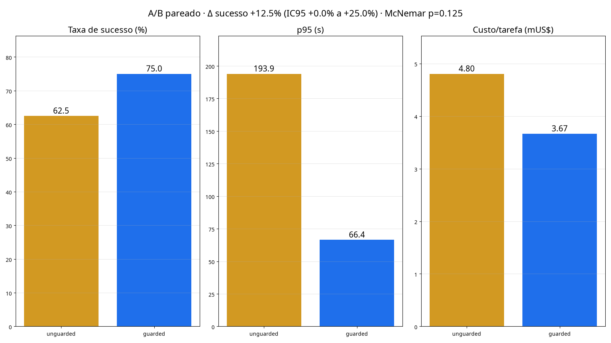
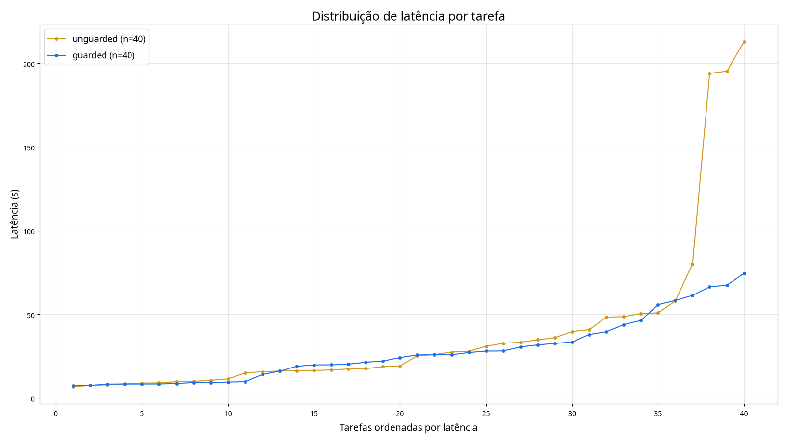
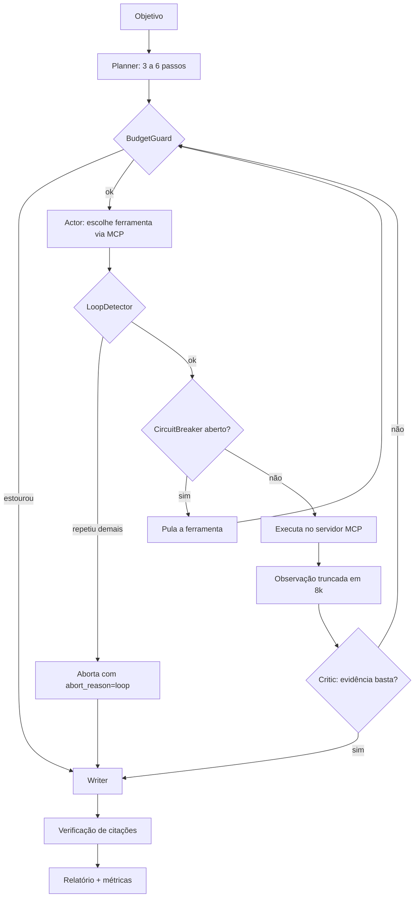

# argus



Agente de pesquisa que recebe um objetivo de alto nível, planeja, executa ferramentas via
**Model Context Protocol** e entrega um relatório com fontes verificadas — medido por um
benchmark de 40 tarefas com grading determinístico.

Agentes são fáceis de demonstrar e difíceis de confiar. Este repo é sobre a parte difícil:
orçamento, detecção de loop, circuit breaker por ferramenta, verificação de citação e um
benchmark que pune enrolação.

**English:** [README.md](README.md)

## Resultados do benchmark

40 tarefas em 4 categorias (10 cada): síntese multi-fonte, cálculo com execução de código,
consulta a dados estruturados e adversariais (URL morta, tarefa impossível, tentativa de
injeção de prompt). Mesma seed, mesmo modelo, dois braços: com e sem guardas.

| Configuração | Sucesso | Loops abortados | p50 (s) | p95 (s) | Custo/tarefa | Citações suportadas |
|---|---|---|---|---|---|---|
| Sem guardas (controle) | 62,5% | 0/40 | 25,1 | 193,9 | US$ 0,00480 | 87,3% |
| **argus (guardas completas)** | **75,0%** | 3/40 | 25,7 | 66,4 | US$ 0,00367 | 87,9% |

Diferença pareada de sucesso: **+12,5 p.p.** (IC95 0,0 a 25,0 p.p.), McNemar exato p = 0,125 com
40 pares. Com 40 tarefas o intervalo é largo: o efeito é direcional, não estatisticamente significativo a 5%.

| Categoria | Sem guardas | argus |
|---|---|---|
| Síntese multi-fonte | 9/10 | 8/10 |
| Cálculo/código | 6/10 | 6/10 |
| Dados estruturados | 4/10 | 6/10 |
| Adversariais | 6/10 | 10/10 |











Metodologia completa, variância e falhas observadas em [`docs/RESULTS.md`](docs/RESULTS.md).

## O que os guardas fazem

| Guarda | Regra | Efeito medido |
|---|---|---|
| `BudgetGuard` | 18 passos, 180k tokens, 180 s, US$ 0,35 por tarefa | encerra com o que já coletou em vez de estourar a conta |
| `LoopDetector` | hash de `(tool, args)`; no limite avisa o ator, e aborta se ele insistir | 3 abortos no braço com guarda |
| `CircuitBreaker` | 3 falhas da mesma ferramenta em 120 s abrem o circuito | evita cascata quando a busca começa a devolver 403 |
| `citations.verify` | toda URL do relatório precisa existir nas evidências coletadas | 87,9% das citações com lastro real |

O `LoopDetector` merece uma nota: ele **não** mascara o problema. A primeira repetição vira
aviso explícito no prompt do ator; se a mesma chamada voltar, a execução é encerrada com
`abort_reason=loop:<ferramenta>` e o writer produz o relatório com o que existe. Abortar é
melhor que pagar 18 passos idênticos, mas o custo aparece: das 3 tarefas
abortadas, 2 não passaram no grader.

## Arquitetura



Ferramentas expostas pelo servidor MCP (stdio):

| Ferramenta | Descrição | Guarda |
|---|---|---|
| `web_search` | busca (DuckDuckGo ou Tavily) com cache em disco | timeout 15 s, cache por query |
| `fetch_page` | extrai texto principal da URL | só http(s), bloqueio de IP privado, limite 1 MB |
| `python_exec` | executa snippet isolado | 10 s de CPU, 512 MB, sem rede, cwd temporário |
| `sqlite_query` | SELECT na base de fixtures | só leitura, limite 500 linhas |
| `calculator` | aritmética exata | whitelist de caracteres |

## Rodar

```bash
cp .env.example .env       # OPENAI_API_KEY e, opcionalmente, TAVILY_API_KEY
make install
make fixture               # cria bench/fixtures/seed.db a partir do seed.sql
make smoke                 # 3 tarefas, para conferir o encanamento
make bench                 # 40 tarefas com guardas
make bench-unguarded       # braço de controle
make ab                    # A/B pareado com bootstrap e McNemar
make plots                 # gráficos a partir dos JSONs reais
```

Execução única:

```bash
argus run "Compare o crescimento de adoção de RAG e de fine-tuning em papers de 2024 e 2025, com números"
```

O relatório sai em Markdown, com a seção `## Fontes`; o CLI imprime também passos, tokens,
custo, latência e quantas citações têm lastro nas evidências.

## Medição

- Modelo: `gpt-5-mini` com `reasoning_effort=minimal` (modelos de raciocínio gastam o orçamento
  de saída pensando e devolvem resposta vazia quando `max_tokens` é pequeno).
- Preço por token vem de tabela por modelo em `src/argus/llm.py`; modelo fora da tabela custa
  0 e emite warning, em vez de inventar preço.
- Custo total dos dois braços: US$ 0,34.
- Execução de 2026-11-25, commit `0aa51d4`, 6 vCPU / 20 GB, sem GPU.

## Limitações

- **Busca**: o provedor padrão é o HTML do DuckDuckGo, sem chave. Em execuções com
  concorrência 3 ele começa a responder 403; o cache reduz a repetição, mas não elimina o
  problema. Tavily é suportado por configuração.
- **`python_exec` não é sandbox de segurança**: é `subprocess` com `-I -S`, `setrlimit` e sem
  rede. Não rode código hostil de verdade nele.
- **Uma seed, não três**: a medição usa temperatura 0 e uma execução por tarefa. A incerteza
  reportada vem do bootstrap pareado sobre as 40 tarefas, não de variância entre seeds.
- **Sem tarefas profundas**: nenhuma tarefa exige mais de três saltos de ferramenta, então o
  benchmark não mede pesquisa longa.
- **MCP SDK**: o projeto fixa `mcp>=1.2,<2`. Com o SDK 2.x o handshake do cliente trava neste
  ambiente; o servidor já tem shim para os dois nomes (`FastMCP`/`MCPServer`).
- **Grading determinístico** cobre termos, números e fontes vivas; ele não julga qualidade de
  prosa. Um relatório correto e mal escrito passa; um relatório bonito e errado não.

## Estrutura

```text
src/argus/          graph, guards, llm, citations, telemetry, nós do agente
mcp_servers/        servidor MCP stdio com as cinco ferramentas
bench/              tasks.jsonl, graders, run_bench, ab, gate, regrade, report
scripts/            reproduce.sh, plot_results.py
tests/              guardas, graders, gate, A/B, llm, citações, sandbox
docs/               RESULTS.md, THREAT_MODEL.md, img/
```

## Licença

MIT.
